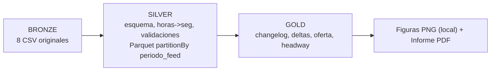

# Plan Final — Proyecto(s) 1 y 2: Análisis de Frecuencias y Headways (GTFS — Buses RM)

> **Documento fusionado** a partir de:
> - `PLAN_PROYECTO_HEADWAYS.md` (plan del equipo: análisis del dataset, metodología de headways, Proyecto 1 + Proyecto 2).
> - `plan proyecto 2.md` — **Plan v2 del compañero** (Proyecto 2: comparación V167 → V168 con jobs J0–J7).
>
> **Dataset:** GTFS unificado de buses RM con `periodo_feed` (A = `20260829` / V167; B = `20261003` / V168).
> **Tecnología:** Apache Spark (PySpark en clúster, `spark-submit`), entrega = informe PDF + figuras PNG.

---

## 1. Contexto y decisiones transversales

1. **Dataset:** GTFS unificado de buses RM (excluye Metro, EFE y BAA). Dos periodos (`periodo_feed`):
   - **A** = `20260829` (V167): vigencia real 29 ago – 2 oct 2026.
   - **B** = `20261003` (V168): vigencia real 3 oct – 31 dic 2026.
2. **Metodología (convergencia):** arquitectura medallón (Bronze → Silver → Gold); Parquet particionado por `periodo_feed`; regla de joins con `periodo_feed`.
3. **Medición de headways (convergencia):** headway programado (`frequencies.headway_secs`) → generar salidas (`n = floor((fin − ini − 1)/headway) + 1`, end exclusivo) → expandir con `stop_times.t_rel` → pasadas absolutas → headway real / oferta.
4. **Decisión vigente:** el equipo se interesa en **headway_secs**, para medir la **irregularidad / bunching** y el **promedio por paradero** (Proyecto 1). Se descarta el Proyecto 2 como entregable final.
5. **Adoptadas del Plan v2 del compañero:** PySpark · ejecución en clúster · entrega como informe PDF con figuras PNG.

---

## 2. Arquitectura del pipeline (fusionada)

- **J0:** ingesta + validaciones (conteos: stop_times 1.7 M, trips/freq 28.950, etc.).
- **J1–J2:** catálogos y cambios (`comparar()`).
- **J3–J5 / J5b:** oferta, salidas, impacto, pasadas (17,3 M) por paradero y hora.
- **J4 / J4b / J6:** secuencias, tramos, trazados.
- **J7:** changelog unificado + resumen.

---

## 3. Medición de headways y oferta (núcleo del Proyecto 1)

1. `frequencies`: headway programado (`headway_secs`), ventana (`start_time`→`end_time`), `exact_times = 0`.
2. Salidas: `n = floor((fin_seg − ini_seg − 1) / headway_secs) + 1`; `salida_k = ini_seg + k·headway_secs`.
3. Pasadas: `pasada_seg = salida_seg + t_rel`; `hora_servicio = floor(pasada_seg / 3600)` (0..27); `hora_reloj = hora_servicio % 24`; `cruza_medianoche = pasada_seg ≥ 86400`.
4. Headway real en paradero: diferencia entre pasadas consecutivas (o entre salidas si es primer paradero).
5. Oferta: `buses/hora = count(pasadas)`; espera media = `30 / buses` (headway/2); flota = intervalos `[salida, salida+dur]` expandidos por hora.
6. Irregularidad / bunching: headway real vs headway programado (`headway_secs`).

---

## 4. Proyecto 2 — Comparación V167 (`20260829`) → V168 (`20261003`)

### 4.1 Objetivo
Changelog automático entre versiones: recorridos/viajes/paraderos agregados o eliminados; paraderos movidos o renombrados; recorridos con cambio de frecuencia (Δ salidas/día); cambios de secuencia/tiempo de viaje; impacto en paraderos.

### 4.2 Hallazgos preliminares (validables en Spark)
| Tema | Resultado |
|---|---|
| Recorrido nuevo | `B46` — 104 salidas/día laboral, 64 sáb, 50 dom |
| Redistribución 301 → 301c | `301` pierde 59+50 salidas (ida+regreso); `301c` gana 34+27 |
| Otros cambios headways | `306`, `G23`, `203c`, `216`, `206`, `228`, `229` (+1 a +6 salidas) |
| Salidas/día totales | L: 64.502 → 64.568 · S: 43.619 → 43.673 · D: 37.377 → 37.408 |
| Paraderos eliminados / nuevos / movidos / renombrados | `PA665`,`PA718`,`PA86`; 13 nuevos; 13 movidos (8–147 m eucl. / 11–160 m Manhattan); 6 renombrados |
| Secuencias distintas | 106 combos recorrido–sentido–día en 36 recorridos; duración distinta en 1.127 viajes |
| Impacto paraderos | 1.125 paradero–día con cambio (443 laboral); `PA299` −444 |

### 4.3 Jobs (fusionados)
- **J0:** ingesta + validación → silver Parquet.
- **J1:** routes → `comparar(routes, ["route_id"], [...])` → B46 NUEVO, 0 mod.
- **J2:** stops → `comparar` + Manhattan (>5 m = movido) + renombrado; contexto viajes.
- **J3:** salidas + trips/freq → `comparar` a nivel trip (22 NUEVO, 94 headway MODIFICADO); nivel recorrido (27 combos con Δ, incl. 301, 301c, B46).
- **J4/J4b:** secuencias (`array_sort`, `array_except`), tramos (Window `lead`, 1.67 M tramos).
- **J5/J5b:** impacto paraderos (`Σ n` por paradero; expand salidas→pasadas 17,3 M → por hora).
- **J6:** shapes (euclidiana entre vértices).
- **J7:** changelog (`unionByName`, full outer join) + resumen.

### 4.4 Figuras e informe (del Plan v2, adoptado)
1. Cambios por entidad/estado (barras apiladas). 2. Δ salidas/día por recorrido–sentido–día. 3. Mapa paraderos. 4. Mapa Δ buses/día. 5. Heatmap Δ buses/hora. 6–8: trazados, histograma, rendimiento.

---

## 5. Plan final: fases, entregables y decisiones pendientes

| Fase | Contenido | Esfuerzo |
|---|---|---|
| 1 | Entorno + ingesta → silver + validaciones | 1 sesión |
| 2 | J1 + J2 + J3 (salidas/pasidas/headway) | 1–2 sesiones |
| 3 | J4–J7 + gold + figures + informe | 2–3 sesiones |

**Decisiones FINALIZADAS (resueltas por el equipo):**
1. **Métrica final del informe:** `headway_secs` (headways).
2. **Uso de `service_id`:** SÍ — la ventana de headway y las agregaciones por paradero se hacen por tipo de día (`service_id`: L/S/D) además de stop/route.
3. **Alcance final:** SOLO **Proyecto 1** (oferta real por paradero y hora / irregularidad-bunching / promedio por paradero). Se descarta el Proyecto 2 como entregable principal.

**Pendientes menores:**
- Lenguaje: PySpark (Plan v2) vs Java/Scala.
- Versión Spark (`spark-submit --version`).
- Gestor clúster.
- Ejecución local vs clúster.

---

## 6. Trampas consolidadas (de ambos planes)

- `periodo_feed` en joins (salvo full outer A⟖B).
- `end_time` exclusivo (`−1` en fórmula).
- Horas: split+cast (no `HH:mm:ss` fijo); 0..27 / %24; medianochesia.
- Nulos: `eqNullSafe`.
- `collect_list` ordenar con `array_sort`.
- No unir `shapes` con `stop_times`.
- `toPandas()` solo sobre gold.
