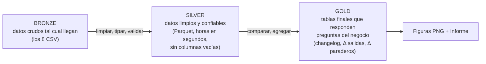
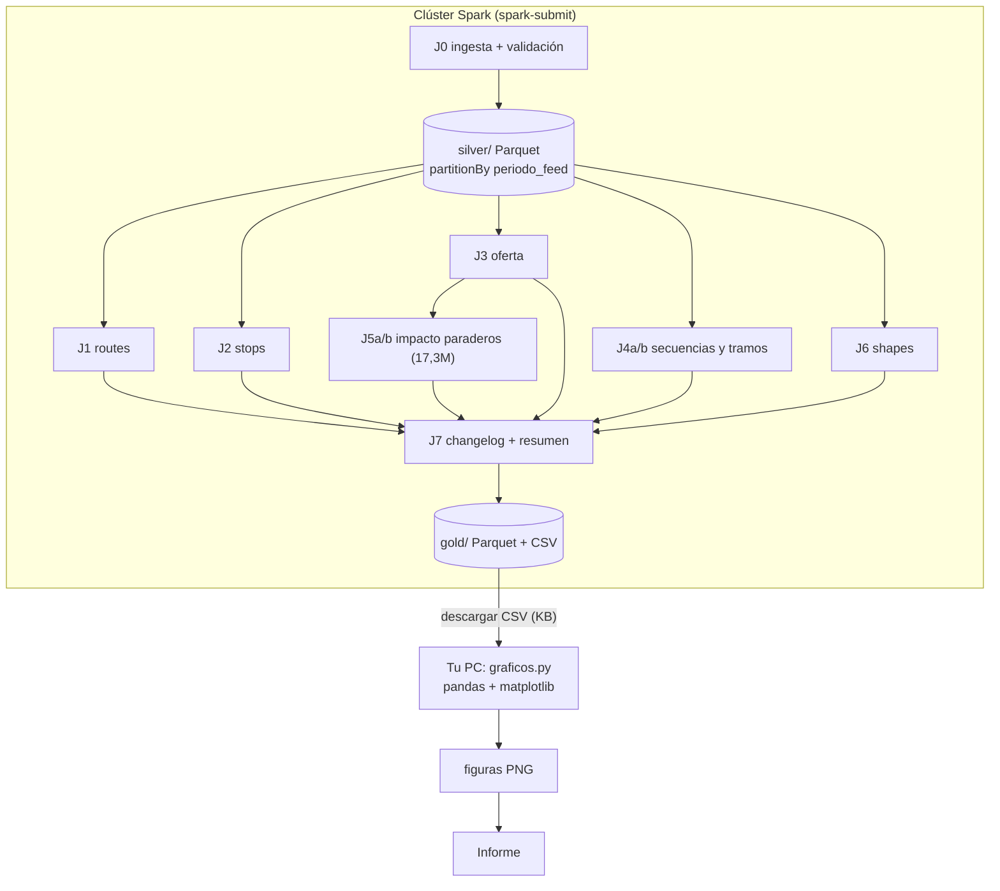

# Plan v2 — Proyecto 2: ¿Qué cambió en la red de buses RM? (V167 → V168)

**Decisiones tomadas:** PySpark · ejecución en clúster Spark · entrega como **informe** · figuras estáticas (PNG) generadas a partir de las tablas resultado · se hace **solo el Proyecto 2**.

---

## 1. Objetivo

Construir un pipeline en PySpark que compare automáticamente las dos versiones del GTFS de buses RM:
- **A** = `periodo_feed = 20260829`, vigente del 29-ago al 2-oct
- **B** = `periodo_feed = 20261003`, vigente desde el 3-oct

El pipeline produce un **registro de cambios** (*changelog*) y un conjunto de tablas resumen. Con ellas se escribe un informe que responde:

1. ¿Qué **recorridos, viajes y paraderos** se agregaron o eliminaron?
2. ¿Qué paraderos se **movieron** (cuántos metros) o se **renombraron**?
3. ¿Qué recorridos cambiaron su **frecuencia**, y cuántos buses/día ganaron o perdieron?
4. ¿Qué recorridos cambiaron su **secuencia de paradas**, su **trazado** o su **tiempo de viaje**?
5. ¿Qué **paraderos ganaron o perdieron servicio** como consecuencia de todo lo anterior?

---

## 2. Hallazgos preliminares (verificados con pandas)

Esto es lo que el pipeline de Spark **debe reproducir**. Sirve como respuesta esperada para validar el código, y además ya sugiere la historia del informe:

| Tema | Resultado preliminar |
| :--- | :--- |
| Recorrido nuevo | **`B46`** "Juan Antonio Ríos – (M) La Moneda": 104 salidas en día laboral, 64 en sábado, 50 en domingo |
| Cambios en `routes` existentes | 0 (sin cambios de nombre ni color) |
| **Redistribución 301 → 301c** | El `301` pierde 59 + 50 salidas en laboral (ida + regreso); el `301c` gana 34 + 27. Parece un reemplazo parcial del servicio corto por el largo, o viceversa, y habrá que interpretarlo |
| Otros cambios de frecuencia | `306` (−), `G23`, `203c`, `216`, `206`, `228`, `229` (+1 a +6 salidas) |
| Total de salidas/día | L: 64.502 → 64.568 · S: 43.619 → 43.673 · D: 37.377 → 37.408 |
| Paraderos eliminados | `PA665`, `PA718`, `PA86` |
| Paraderos nuevos | 13 (`PA736`, `PA75`, `PA76`, `PA769`, `PB2249`, …). Varios `PA7xx` con 460 buses/día parecen ser del `B46` |
| Paraderos movidos | 13, entre **8 y 147 m** (euclidiana) / **11 y 160 m** (Manhattan) |
| **Paraderos renombrados** | 6. Ej.: "Salesianos" → "Pdte. S. Allende", lo que sugiere un **cambio de nombre de calle** |
| Secuencias de paradas distintas | 106 combinaciones recorrido–sentido–día, en **36 recorridos** |
| Trazados (`shapes`) con largo distinto | Solo **4 de 839**. La mayoría de los cambios de secuencia son paradas agregadas o quitadas sobre el mismo trazado |
| Duración de viaje distinta | 1.127 viajes, entre −3,6 y +2,8 min |
| Paraderos con cambio de buses/día | 1.125 combinaciones paradero–día (443 en laboral). Ej.: `PA299` pierde 444 buses/día laboral |

---

## 2.5 ¿Dónde se usa el "big data"? (requisito: > 1 millón de filas)

`stop_times` (**1.700.914 filas**) es la tabla que cumple el requisito. Tras esta revisión, **4 de los 8 jobs** la procesan completa, y dos de ellos generan tablas intermedias aún más grandes:

| Job | Qué hace con `stop_times` | Filas procesadas | Operación Spark pesada |
| :--- | :--- | ---: | :--- |
| **J0** Ingesta | Lectura, tipado, conversión de horas, validación de llaves y escritura en Parquet | 1,7 M | Escaneo completo + `groupBy` de unicidad + `left_anti` |
| **J4a** Secuencias | Arma la secuencia ordenada de paradas de cada viaje | 1,7 M → 28.950 | `groupBy` + `collect_list` + `array_sort` (shuffle) |
| **J4b** Tramos *(nuevo)* | Pares de paradas consecutivas: tiempo y distancia de cada tramo, A vs B | **1.671.964 tramos** | `Window` + `lead` sobre 1,7 M + join A⋈B por tramo |
| **J5** Impacto paraderos | **Expande** cada viaje en todas sus pasadas por paradero y hora | 1,7 M × salidas → **17.324.729** | `explode` + join grande + `groupBy` por paradero y hora |

Para el informe, la frase clave es: *"el pipeline procesa 1,7 M de registros de paradas y genera una tabla intermedia de 17,3 M de pasadas por paradero"*.

> [!NOTE]
> Siendo honestos, 1,7 M de filas (88 MB) es poco para Spark: pandas también lo maneja. La expansión a **17,3 M** del J5 es la que justifica de verdad el clúster. Conviene medir y reportar en el informe los tiempos de cada job, cuántas particiones usó y cuántos ejecutores. Así se muestra el trabajo distribuido y no solo el resultado.

---

## 3. Conceptos clave (respuesta a tus comentarios)

### 3.1 ¿Qué es "gold" y por qué Parquet?

**Gold** viene de la **arquitectura medallón**, una convención para organizar un pipeline de datos en tres capas según su nivel de refinamiento:



| Capa | Contenido en este proyecto | ¿Quién la usa? |
| :--- | :--- | :--- |
| **Bronze** | Los CSV originales, sin tocar | Solo la ingesta |
| **Silver** | Las mismas 8 tablas, con tipos correctos, horas convertidas a segundos y validadas | Los jobs de comparación |
| **Gold** | Resultados: `changelog`, `delta_salidas_recorrido`, `delta_paraderos`, etc. | El informe y los gráficos |

La ventaja es que cada capa se puede recalcular de forma independiente. Si cambias un gráfico, no reprocesas los CSV. Si encuentras un error en la limpieza, rehaces silver y gold y bronze queda intacto.

**¿Por qué Parquet y no CSV?**

| Característica | CSV | Parquet |
| :--- | :--- | :--- |
| Organización | Por **filas**, como texto | Por **columnas**, en binario |
| Leer 2 de 9 columnas | Lee y parsea **todo** el archivo | Lee **solo esas 2 columnas** |
| Tipos de dato | Se pierden: todo es texto y hay que re-parsear cada vez | Se guardan en el archivo (int, double, string) |
| Tamaño | Grande (`stop_times` = 88 MB) | Comprimido (snappy). Típicamente varias veces más chico; lo mediremos en el anexo |
| Filtrar `periodo_feed = 20261003` | Lee todo y descarta | Con `partitionBy("periodo_feed")` **ni siquiera abre** los archivos del otro periodo (*partition pruning*) |
| Lectura en paralelo en el clúster | Limitada (un `.csv.gz` no se puede dividir) | Se divide en bloques que leen varios ejecutores a la vez |

En un **clúster** esto pesa más que en local, porque cada byte leído de más viaja por la red. Y el *partition pruning* calza con este proyecto, donde todo el tiempo se separa A de B.

> [!NOTE]
> Las tablas gold se guardan en **Parquet** como resultado oficial y también en **CSV**, porque son pequeñas (cientos o miles de filas). El CSV permite abrirlas en Excel, pegarlas en el informe o graficarlas con pandas en tu computador.

### 3.2 Distancia Manhattan sobre coordenadas lat/lon

**Idea:** en una ciudad con calles en cuadrícula no se camina "en línea recta" sino por las cuadras: un tramo este–oeste más un tramo norte–sur. La distancia Manhattan suma esos dos tramos.

**Problema:** las coordenadas están en **grados**, no en metros, y un grado de longitud mide menos que un grado de latitud (los meridianos se juntan hacia los polos). En Santiago (latitud ≈ −33,45°):
- 1° de latitud ≈ 111,2 km
- 1° de longitud ≈ 111,2 × cos(33,45°) ≈ **92,8 km**

**Cálculo:** a distancias de pocos km la Tierra se puede tratar como plana (proyección equirectangular):

$$
\Delta y = R \cdot |\Delta\varphi| \qquad
\Delta x = R \cdot |\Delta\lambda| \cdot \cos(\bar{\varphi}) \qquad
d_{Manhattan} = \Delta x + \Delta y
$$

donde $R = 6.371.000$ m, $\varphi$ = latitud y $\lambda$ = longitud **en radianes**, y $\bar{\varphi}$ = latitud media de los dos puntos. Para comparar, la euclidiana es $d_E = \sqrt{\Delta x^2 + \Delta y^2}$, y siempre se cumple que $d_E \le d_{Manhattan} \le \sqrt{2}\, d_E$.

**En PySpark** (funciones nativas, sin UDF):
```python
from pyspark.sql import functions as F

R = 6_371_000.0

def componentes_m(lat1, lon1, lat2, lon2):
    lat_media = F.radians((F.col(lat1) + F.col(lat2)) / 2)
    dy = F.abs(F.radians(F.col(lat2) - F.col(lat1))) * R
    dx = F.abs(F.radians(F.col(lon2) - F.col(lon1))) * R * F.cos(lat_media)
    return dx, dy

def dist_manhattan_m(lat1, lon1, lat2, lon2):
    dx, dy = componentes_m(lat1, lon1, lat2, lon2)
    return dx + dy

def dist_euclidiana_m(lat1, lon1, lat2, lon2):
    dx, dy = componentes_m(lat1, lon1, lat2, lon2)
    return F.sqrt(dx * dx + dy * dy)
```

**Cuándo usar cada una (recomendación):**

| Caso | Distancia recomendada | Motivo |
| :--- | :--- | :--- |
| **Paradero movido** (posición A → B) | **Manhattan** ✅ | No se conoce el camino; Manhattan aproxima lo que camina un pasajero por las cuadras. Tu intuición aplica bien aquí |
| **Largo de un trazado** (`shapes`) | **Euclidiana entre vértices consecutivos** | El *shape* ya sigue las calles punto a punto. Aplicar Manhattan a cada tramito cuenta de más en calles diagonales: en estos datos infla el largo total en un **21%** (20,6 km → 24,9 km promedio) |

Valores reales de los 13 paraderos movidos (algunos):

| Paradero | Euclidiana (m) | Manhattan (m) |
| :--- | ---: | ---: |
| PF482 (Av. Los Toros) | 147,4 | 159,5 |
| PD407 (Parada 6 / M Príncipe de Gales) | 90,0 | 99,5 |
| PF259 (Ángel Pimentel) | 66,2 | 92,1 |
| PH340 (Club Hípico) | 8,0 | 11,0 |

> [!TIP]
> **Refinamiento opcional para el informe:** la cuadrícula de Santiago no está perfectamente alineada al norte. Si se rotan los ejes en el ángulo $\theta$ de las calles ($\Delta x' = \Delta x\cos\theta + \Delta y\sin\theta$, $\Delta y' = -\Delta x\sin\theta + \Delta y\cos\theta$) y luego se aplica $|\Delta x'| + |\Delta y'|$, la Manhattan se ajusta mejor a la trama real. Para el informe basta con mencionarlo como limitación.

Clasificación propuesta para paraderos movidos (con Manhattan): **< 5 m** ajuste de coordenada (ruido), **5–50 m** reubicación menor (misma cuadra), **> 50 m** reubicación mayor. Con los datos actuales: 0 / 8 / 5.

---

## 4. Arquitectura en el clúster



- **Almacenamiento: HDFS.** Los CSV todavía no están subidos. Pasos (una sola vez):
  ```bash
  # 1. Desde tu PC: copiar los CSV al nodo del clúster
  scp dataset_buses_rm/*.csv usuario@nodo:~/patos/bronze/
  # 2. En el nodo (por SSH): subirlos a HDFS
  hdfs dfs -mkdir -p /user/usuario/patos/bronze
  hdfs dfs -put ~/patos/bronze/*.csv /user/usuario/patos/bronze/
  hdfs dfs -ls -h /user/usuario/patos/bronze      # verificar tamaños
  ```
  Todas las rutas van en `config.py` (`BASE = "hdfs:///user/usuario/patos"`) con subcarpetas `bronze/`, `silver/` y `gold/`.
- **Ejecución: `spark-submit` por SSH.** Se copia la carpeta `src/` al nodo con `scp` y se lanza, por ejemplo, `spark-submit --py-files src/comun.py,src/config.py src/j4_secuencias.py`. Para que `comun.py` y `config.py` lleguen a los ejecutores se pasan con `--py-files`.
- **Primer paso: conocer la versión de Spark.** Ejecutar `spark-submit --version` en el nodo. El plan evita depender de la versión: para pasar columnas a filas usa `stack()` vía `selectExpr`, que funciona en Spark 2.x, 3.x y 4.x, en vez de `unpivot()`, que requiere ≥ 3.4.
- **Spark UI / History Server:** guardar capturas del DAG y de las etapas del J5 (shuffle, número de tareas). Sirven como evidencia del procesamiento distribuido en el informe.
- **Gráficos fuera del clúster:** las tablas gold pesan KB. Se descargan como CSV y un script local con pandas + matplotlib genera los PNG, así que no hace falta instalar matplotlib en los nodos.

### Estructura del repositorio
```
proyecto patos/
├── dataset_buses_rm/          # bronze (CSV originales)
├── src/
│   ├── config.py              # rutas, periodos A/B, umbrales
│   ├── comun.py               # SparkSession, esquemas, a_segundos(), distancias, comparar()
│   ├── j0_ingesta.py
│   ├── j1_routes.py
│   ├── j2_stops.py
│   ├── j3_oferta.py
│   ├── j4_secuencias.py
│   ├── j5_impacto_paraderos.py
│   ├── j6_shapes.py
│   └── j7_changelog.py
├── graficos/graficos.py       # local: gold CSV -> PNG
└── informe/                   # figuras + documento final
```

---

## 5. Pipeline detallado

### J0 — Ingesta (bronze → silver) y validación
1. Leer los 8 CSV con **esquema explícito** (`StructType`).
2. Quitar las columnas siempre vacías.
3. Convertir las horas a segundos sin UDF. Esto resuelve los 27.086 tiempos con formato `0:00:00` y las horas ≥ 24:
   ```python
   def a_segundos(col):
       p = F.split(F.col(col), ":")
       return p[0].cast("int") * 3600 + p[1].cast("int") * 60 + p[2].cast("int")
   ```
4. Escribir en Parquet con `partitionBy("periodo_feed")`.
5. **Validaciones:** conteos iguales al README, llaves primarias únicas, sin huérfanos (`left_anti` = 0 filas).
6. Anexo de rendimiento: tamaño en disco y tiempo de un `count()` + `groupBy` sobre CSV vs Parquet.

### Pieza central — función genérica `comparar()` (en `comun.py`)
```python
from functools import reduce

def comparar(df, llaves, columnas, a="20260829", b="20261003"):
    A = df.filter(F.col("periodo_feed") == a).select(
        *llaves, F.lit(True).alias("en_a"), *[F.col(c).alias(f"{c}_a") for c in columnas])
    B = df.filter(F.col("periodo_feed") == b).select(
        *llaves, F.lit(True).alias("en_b"), *[F.col(c).alias(f"{c}_b") for c in columnas])
    distinto = reduce(lambda x, y: x | y,
                      [~F.col(f"{c}_a").eqNullSafe(F.col(f"{c}_b")) for c in columnas])
    return (A.join(B, llaves, "full_outer")
             .withColumn("estado",
                 F.when(F.col("en_a").isNull(), "NUEVO")
                  .when(F.col("en_b").isNull(), "ELIMINADO")
                  .when(distinto, "MODIFICADO")
                  .otherwise("SIN_CAMBIO")))
```
El join es **por la llave natural sin `periodo_feed`**. Es la única excepción a la regla del README, y es válida porque A y B se separaron antes con un filtro.

### J1 — Recorridos (`routes`)
- `comparar(routes, ["route_id"], ["route_short_name", "route_long_name", "route_color", "route_text_color"])`
- **Esperado:** 1 NUEVO (`B46`), 0 MODIFICADO, 417 SIN_CAMBIO.
- Gold: `g_routes_cambios`

### J2 — Paraderos (`stops`)
1. `comparar(stops, ["stop_id"], ["stop_name", "stop_lat", "stop_lon"])`.
2. Para los MODIFICADO, separar dos tipos de cambio:
   - **Movido:** `dist_manhattan_m(...) > 5` (tolerancia; nunca comparar flotantes con `==`). También se guarda la euclidiana.
   - **Renombrado:** `stop_name_a != stop_name_b`. Un paradero puede ser ambas cosas (ej. `PF482`, `PH340`).
3. Categoría del movimiento: ruido / menor / mayor (ver §3.2).
4. **Contexto:** qué recorridos usaban cada paradero **eliminado** (en A) y cuáles usan cada **nuevo** (en B), con un join con `stop_times` + `trips` y `collect_set(route_id)`.
- **Esperado:** 3 eliminados, 13 nuevos, 13 movidos, 6 renombrados.
- Gold: `g_stops_cambios` (con lat/lon A y B para los mapas)

### J3 — Oferta: viajes, frecuencias y salidas/día
1. **Salidas por ventana** (`end_time` exclusivo, porque las ventanas son contiguas):
   $n = \left\lfloor \dfrac{fin - ini - 1}{headway} \right\rfloor + 1$
   > [!WARNING]
   > Con `end_time` inclusivo se cuentan ~21 mil salidas de más en total: la salida justo en el borde queda en dos ventanas a la vez.
2. Nivel `trip_id`: `comparar(trips ⋈ frequencies, ["trip_id"], ["start_time", "end_time", "headway_secs", "shape_id", "trip_headsign"])`. **Esperado:** 22 NUEVO, 94 con headway MODIFICADO.
3. **Nivel recorrido** (el que va al informe): `groupBy(route_id, direction_id, service_id)` → `sum(n)` en A y en B, Δ absoluto y Δ %. **Esperado:** 27 combinaciones con cambio, incluidas `301`, `301c` y `B46`.
4. **Opcional: ¿en qué horario cambió?** Expandir las salidas con `explode(sequence(0, n-1))` (son solo 291 mil filas) y comparar salidas por hora para los recorridos con cambio. Responde "el 301 perdió buses en punta o en valle".
- Gold: `g_trips_cambios`, `g_delta_salidas_recorrido`, *(opc.)* `g_delta_salidas_hora`

### J4 — Secuencias de paradas y tiempos de viaje
1. Secuencia ordenada por viaje (`collect_list` **no garantiza orden**, por eso el `array_sort` sobre el struct):
   ```python
   seq = (stop_times.groupBy("periodo_feed", "trip_id")
          .agg(F.array_sort(F.collect_list(F.struct("stop_sequence", "stop_id"))).alias("s"),
               F.max("t_rel").alias("duracion_seg"))
          .withColumn("paradas", F.col("s.stop_id")))
   ```
2. A vs B por `trip_id`:
   - `array_except(paradas_b, paradas_a)` → **agregadas**
   - `array_except(paradas_a, paradas_b)` → **quitadas**
   - `duracion_b − duracion_a` → **Δ tiempo de viaje**
3. **Deduplicar por recorrido–sentido–día**, porque muchos `trip_id` comparten la misma secuencia. Se informan 106 combinaciones (36 recorridos), no 821 filas repetidas.
4. Cruzar con J2: ¿las paradas agregadas son los paraderos **nuevos**? ¿Las quitadas son los **eliminados**? Esto conecta ambos niveles en el informe.
- Gold: `g_secuencias_cambios`, `g_delta_duracion`

### J4b — Tramos entre paradas consecutivas (procesa los 1,7 M completos)
El J4a dice **qué viajes** cambiaron su duración (1.127). El J4b dice **en qué tramo** cambió el tiempo.
1. Con una ventana sobre todo `stop_times`, cada parada se empareja con la siguiente:
   ```python
   w = Window.partitionBy("periodo_feed", "trip_id").orderBy("stop_sequence")
   tramos = (stop_times
       .withColumn("stop_sig", F.lead("stop_id").over(w))
       .withColumn("t_sig", F.lead("t_rel").over(w))
       .filter(F.col("stop_sig").isNotNull())                  # 1.671.964 tramos
       .withColumn("seg_tramo", F.col("t_sig") - F.col("t_rel")))
   ```
2. Agregar la **distancia Manhattan** del tramo (join broadcast con `stops` para las coordenadas de origen y destino) y la **velocidad programada** (km/h) del tramo.
3. Deduplicar por tramo físico `(route_id, direction_id, stop_id, stop_sig)` y comparar A vs B: tramos **nuevos**, **eliminados** y con **Δ tiempo** ≠ 0.
4. Resultado: ranking de los tramos donde más cambió el tiempo programado. Explica de dónde vienen los ±3 min del J4a.
- Gold: `g_delta_tramos`

### J5 — Impacto en paraderos (buses/día por paradero)
No hace falta expandir a 17 M de filas: **buses/día en un paradero = Σ salidas/día de los viajes que pasan por él**.
```python
n_por_trip = salidas_trip.select("periodo_feed", "trip_id", "n")        # 28.950 filas -> broadcast
buses = (stop_times.join(F.broadcast(n_por_trip), ["periodo_feed", "trip_id"])
         .join(F.broadcast(trips_min), ["periodo_feed", "trip_id"])
         .groupBy("periodo_feed", "service_id", "stop_id").agg(F.sum("n").alias("buses_dia")))
```
- Comparar A vs B por `(service_id, stop_id)`, con Δ y Δ %, y agregar `buses_semana = 5·L + S + D`.
- Rankings: top 20 que **más ganan** y top 20 que **más pierden** (`Window` + `row_number`).
- **Esperado:** 1.125 paradero–día con cambio (443 en laboral); `PA299` −444 en laboral.
- Gold: `g_delta_paraderos` (con lat/lon para el mapa)

**J5b — Expansión completa a pasadas por hora (17,3 M de filas: el paso "big data")**
El cálculo anterior da el total diario. Para saber **a qué hora** ganó o perdió servicio cada paradero hay que reconstruir cada pasada:
```python
salidas = (freq
    .withColumn("k", F.explode(F.sequence(F.lit(0), F.col("n") - 1)))       # 291.147 salidas
    .withColumn("salida_seg", F.col("ini_seg") + F.col("k") * F.col("headway_secs")))
pasadas = (salidas.join(stop_times, ["periodo_feed", "trip_id"])            # 17.324.729 filas
    .join(F.broadcast(trips_min), ["periodo_feed", "trip_id"])              # agrega service_id
    .withColumn("hora", ((F.col("salida_seg") + F.col("t_rel")) / 3600).cast("int") % 24))
oferta_hora = pasadas.groupBy("periodo_feed", "service_id", "stop_id", "hora").count()
```
- Comparar A vs B por `(service_id, stop_id, hora)` → Δ buses por paradero y hora.
- **Control de consistencia:** la suma por hora de cada paradero debe igualar el `buses_dia` del cálculo diario. Es una validación cruzada entre los dos métodos.
- **Experimento de rendimiento para el informe:** medir el tiempo del J5b variando `spark.sql.shuffle.partitions` (ej. 8 / 32 / 200) y con/sin `broadcast` de `trips`. Da una tabla corta y concreta de "cómo se comporta Spark".
- Gold: `g_delta_paraderos_hora`

### J6 — Trazados (`shapes`)
- Largo de cada `shape_id` = suma de distancias **euclidianas** entre vértices consecutivos (`lag` sobre `Window.partitionBy("periodo_feed", "shape_id").orderBy("shape_pt_sequence")`).
- A vs B: **esperado** 4 shapes con Δ largo > 10 m, más el shape nuevo del `B46`.
- Gold: `g_shapes_cambios` y, para graficar, los vértices **solo** de los shapes que cambiaron (cientos de filas, no 800 mil).

> [!CAUTION]
> Nunca hacer join de `shapes` con `stop_times`: se generan cientos de millones de filas (advertencia del README_2).

### J7 — Changelog unificado + resumen
- Cada job aporta filas con el mismo esquema y se juntan con `unionByName`:

| entidad | id | estado | campo | valor_antes | valor_despues | detalle |
| :--- | :--- | :--- | :--- | :--- | :--- | :--- |
| recorrido | B46 | NUEVO | — | — | Juan Antonio Ríos – (M) La Moneda | 104 salidas L |
| paradero | PF482 | MODIFICADO | ubicación | (-33.xx, -70.xx) | (-33.xx, -70.xx) | 159,5 m Manhattan |
| paradero | PH626 | MODIFICADO | nombre | Salesianos / esq. Romeo | Pdte. S. Allende G. / esq. Romeo | |
| viaje | 228-I-S-B14 | MODIFICADO | headway_secs | 1200 | 900 | |
| recorrido-sentido | 301-I-L | MODIFICADO | salidas_dia | 242 | 183 | −24,4 % |

- Para pasar de columnas `_a`/`_b` a filas se usa `stack()` o `unpivot()`.
- Resumen: `groupBy("entidad", "estado").count()` → `g_resumen`.

---

## 6. Catálogo de tablas gold

| Tabla | Grano (1 fila =) | Filas aprox. | Uso en el informe |
| :--- | :--- | ---: | :--- |
| `g_resumen` | entidad × estado | ~15 | Tabla 1, Figura 1 |
| `g_routes_cambios` | recorrido | 418 | Texto |
| `g_stops_cambios` | paradero con cambio | ~35 | Figura 3, Tabla 2 |
| `g_trips_cambios` | viaje con cambio | ~120 | Anexo |
| `g_delta_salidas_recorrido` | recorrido × sentido × día | 1.905 (27 con cambio) | Figura 2 |
| `g_delta_salidas_hora` *(opc.)* | recorrido × sentido × día × hora | ~600 | Figura 7 |
| `g_secuencias_cambios` | recorrido × sentido × día | 106 | Tabla 3 |
| `g_delta_duracion` | viaje | 1.127 | Figura 5 |
| `g_delta_paraderos` | paradero × día | ~1.125 | Figura 4, Tabla 4 |
| `g_delta_tramos` | tramo físico con cambio | cientos | Tabla 3 |
| `g_delta_paraderos_hora` | paradero × día × hora | miles | Figura 5 |
| `g_rendimiento` | job × configuración | ~15 | Tabla 5 |
| `g_shapes_cambios` (+ vértices) | shape | ~5 | Figura 6 |
| `g_changelog` | cambio individual | cientos | Anexo completo |

---

## 7. Figuras del informe (PNG desde las tablas gold)

Como el PDF es corto, se proponen **5 figuras principales** y el resto queda como opcional o anexo.

| # | Figura | Tipo | Tabla fuente | Prioridad |
| :--- | :--- | :--- | :--- | :--- |
| 1 | Cambios por entidad y estado | Barras apiladas | `g_resumen` | ⭐ principal |
| 2 | Δ salidas/día por recorrido–sentido–día (301, 301c, B46, …) | Barras horizontales divergentes | `g_delta_salidas_recorrido` | ⭐ principal |
| 3 | Mapa de paraderos nuevos / eliminados / movidos (flecha A→B) | Dispersión lon/lat | `g_stops_cambios` + silver `stops` | ⭐ principal |
| 4 | Mapa de Δ buses/día laboral por paradero | Dispersión con colormap divergente | `g_delta_paraderos` | ⭐ principal |
| 5 | Δ buses por hora en los paraderos más afectados (heatmap hora × paradero) | Heatmap | `g_delta_paraderos_hora` (J5b, 17 M) | ⭐ principal |
| 6 | Trazados que cambiaron + B46 | Líneas lon/lat | `g_shapes_cambios` | opcional |
| 7 | Histograma de Δ tiempo de viaje | Histograma | `g_delta_duracion` | opcional |
| 8 | Tiempo del J5b según particiones / broadcast; CSV vs Parquet | Barras (o tabla) | `g_rendimiento` | anexo |

Los mapas son dispersiones lon/lat con matplotlib, sin mapa base (no requiere internet). Es suficiente porque los ~24 mil paraderos en gris ya dibujan la forma de Santiago.

---

## 8. Estructura propuesta del informe (PDF corto, ~8–12 páginas)

1. **Introducción** (½ pág.): GTFS, DTPM, motivación (la red cambia y nadie publica un "diff").
2. **Datos** (1 pág.): los dos periodos, tamaño de cada tabla (destacando `stop_times` con 1,7 M) y modelo entidad-relación.
3. **Metodología** (2–3 págs.):
   - Arquitectura medallón en HDFS y Parquet (§3.1)
   - Función `comparar` (full outer join + `eqNullSafe`)
   - Expansión de frecuencias a salidas y a 17,3 M de pasadas
   - Distancia Manhattan (§3.2)
   - Ejecución en el clúster, con una tabla de volumen por job (§2.5)
4. **Resultados** (3–5 págs.): figuras 1–5, más tablas cortas (top paraderos y top tramos).
5. **Rendimiento** (½–1 pág.): tiempos por job y experimento de particiones/broadcast del J5b.
6. **Limitaciones y conclusiones** (½ pág.): salidas teóricas (`exact_times = 0`), oferta programada y no demanda real, aproximación plana en las distancias.
7. **Anexo:** changelog resumido y extractos de código.

---

## 9. Trampas a evitar

| Trampa | Consecuencia | Solución |
| :--- | :--- | :--- |
| Comparar con `!=` cuando hay nulos | `null != x` da `null`, el cambio no se detecta | `eqNullSafe` (`<=>` en SQL) |
| Comparar coordenadas con `==` | Falsos "movidos" por decimales | Distancia + tolerancia (5 m) |
| `end_time` inclusivo | ~21 mil salidas fantasma | Fórmula con `−1` |
| `collect_list` sin ordenar | Secuencias "distintas" que en realidad son iguales | `array_sort(struct(stop_sequence, stop_id))` |
| Parsear horas con `to_timestamp("HH:mm:ss")` | Falla con `0:00:00` y con `25:15:00` | `split` + aritmética |
| Join de `shapes` con `stop_times` | Cientos de millones de filas | Procesar `shapes` aparte |
| Rutas locales en el clúster | `FileNotFound` en los ejecutores | Almacenamiento compartido + `config.py` |
| `toPandas()` sobre tablas grandes | El driver se queda sin memoria | Solo sobre tablas gold |

---

## 10. Cronograma sugerido

| Fase | Contenido | Esfuerzo |
| :--- | :--- | :--- |
| 1 | `spark-submit --version`, subir CSV a HDFS, `config.py`, `comun.py`, J0 + validaciones | 1 sesión |
| 2 | J1 + J2 (`comparar` + Manhattan) | 1 sesión |
| 3 | J3 + J5 + **J5b** (oferta, impacto y expansión a 17 M) + experimento de rendimiento | 1–2 sesiones |
| 4 | J4a + **J4b** + J6 (secuencias, tramos, trazados) | 1 sesión |
| 5 | J7 changelog + `graficos.py` (5 figuras principales) | 1 sesión |
| 6 | Redacción del informe PDF | 1 sesión |

## 11. Checklist de verificación (valores esperados)
- [ ] J0: conteos = README (1.700.914 stop_times, 28.950 trips, …)
- [ ] J1: 1 recorrido NUEVO (`B46`), 0 modificados
- [ ] J2: 3 eliminados · 13 nuevos · 13 movidos · 6 renombrados
- [ ] J3: 291.147 salidas totales · 22 trips nuevos · 94 headways · 27 recorrido–sentido–día con Δ salidas
- [ ] J4: 106 recorrido–sentido–día con secuencia distinta (36 recorridos) · 1.127 trips con Δ duración
- [ ] J5: 1.125 paradero–día con Δ (443 laboral)
- [ ] J4b: 1.671.964 tramos (= 1.700.914 − 28.950 viajes)
- [ ] J5b: 17.324.729 pasadas; la suma por hora = `buses_dia` de J5
- [ ] J6: 4 shapes con Δ largo > 10 m (+ shape nuevo del B46)
- [ ] Revisión manual de 2–3 casos (ej. `301-I-L`, `PF482`, `B46`)

---

## 12. Decisiones y pendientes
| Tema | Estado |
| :--- | :--- |
| Almacenamiento | ✅ HDFS (CSV aún por subir, ver §4) |
| Envío de trabajos | ✅ `spark-submit` por SSH |
| Informe | ✅ PDF corto (~8–12 págs.), 5 figuras principales |
| Versión de Spark | ⏳ Pendiente: ejecutar `spark-submit --version` en el nodo. El plan ya es compatible con 3.x y 4.x |
| Gestor del clúster | ⏳ Aparece en la UI del clúster o en la salida de `spark-submit` (`--master yarn` / `spark://...`) |
