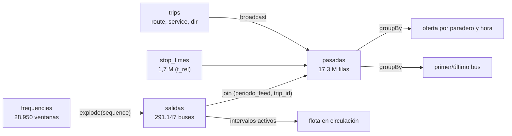
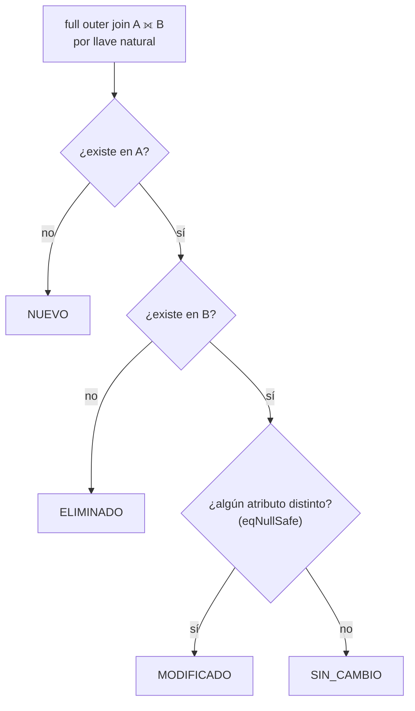

# Plan detallado — Proyectos 1 y 2 con Apache Spark (GTFS Buses RM)

- **Proyecto 1:** Oferta real de buses por paradero y hora (mapa de calor)
- **Proyecto 2:** Comparación entre periodos `20260829` (V167) y `20261003` (V168)

Los dos proyectos comparten la ingesta. Además, el Proyecto 2 reutiliza el resultado del Proyecto 1 para medir cómo cambió la oferta en cada paradero, así que conviene hacerlos en ese orden.

---

## 0. Lo que ya revisé de los datos (exploración previa con pandas)

Antes de planificar revisé los CSV para que el plan se base en datos reales y no en supuestos:

| Hallazgo | Valor | Por qué importa |
| :--- | ---: | :--- |
| Ventanas de frecuencia (`frequencies`) | 28.950 | Cada una es un `trip_id` (1:1, sin duplicados) |
| `headway_secs` mín / mediana / máx | 186 / 900 / 19.800 s | De ~3 min en punta hasta 5,5 h en servicios nocturnos |
| **Salidas teóricas totales** (2 periodos) | **291.147** | Tamaño de la tabla `salidas` |
| **Pasadas por paradero** (salidas × paradas) | **17.324.729** | Tamaño de la tabla grande del Proyecto 1 (~8,66 M por periodo) |
| Duración de viaje mediana / máx | 63 / 198 min | Varios servicios terminan después de medianoche |
| Ventanas cuyo último bus cruza las 24:00 | 3.462 | Aparecen horas de paso ≥ `24:00:00` |
| `end_time` máximo | `24:00:00` | Ninguna ventana *empieza* después de medianoche |
| Tiempos con formato `0:00:00` (7 caracteres) | 27.086 | No usar un patrón fijo `HH:mm:ss` para parsear |
| Ventanas de un mismo recorrido | **contiguas** (`end` de una = `start` de la siguiente) | El `end_time` debe ser **exclusivo** (ver trampa 1.6-A) |
| Ruta nueva en octubre | `B46` | Caso NUEVO |
| Trips solo en octubre / solo en agosto | 22 / 0 | |
| Paraderos solo ago / solo oct | 3 / 13 | Bajas y altas |
| Paraderos con coordenada movida / nombre cambiado | 13 / 6 | |
| Trips con `headway` distinto | 94 (en 10 rutas: 203c, 206, 208, 216, 228, 229, 301, 301c, 306, G23) | Cambios de frecuencia |
| Trips con secuencia de paradas distinta | 821 de 14.464 | Desvíos o cambios de trazado |
| Trips con duración total distinta | 1.127 (entre −3,6 y +2,8 min) | Ajustes de tiempos de viaje |

> [!NOTE]
> Como hay 17 M de filas en la tabla de pasadas, Spark se justifica pero el volumen sigue siendo manejable en un notebook local (4–8 GB de memoria para el driver).

---

## 1. Base común (ambos proyectos)

### 1.1 Entorno
- `pyspark` **no está instalado** en el entorno. Tienes **Java 25**. Spark 4.x soporta oficialmente Java 17/21, así que lo más seguro es instalar **OpenJDK 21** junto a la 25 y apuntar `JAVA_HOME` a ella.
- Crear un entorno virtual: `pyspark`, `pandas`, `matplotlib`/`seaborn` y, opcionalmente, `folium` para mapas.
- `SparkSession` local: `master("local[*]")`, `spark.driver.memory=6g`, `spark.sql.shuffle.partitions=32` (el valor por defecto, 200, es excesivo para este volumen).

### 1.2 Estructura de carpetas propuesta
```
proyecto patos/
├── dataset_buses_rm/            # CSV originales (no se tocan)
├── src/
│   ├── comun.py                 # SparkSession, esquemas, parseo de horas, lectura
│   ├── p0_ingesta.py            # CSV -> Parquet (capa "silver")
│   ├── p1_oferta.py             # Proyecto 1
│   └── p2_comparacion.py        # Proyecto 2
├── data/
│   ├── silver/                  # Parquet limpio, particionado por periodo_feed
│   └── gold/                    # Resultados agregados (p1_*, p2_*)
├── notebooks/                   # Exploración y gráficos
└── reportes/                    # Figuras, CSV finales, informe
```

### 1.3 Ingesta (`p0_ingesta.py`)
1. Leer cada CSV con **esquema explícito** (`StructType`), sin `inferSchema`. Es más rápido y evita que `periodo_feed` o `stop_id` se infieran con un tipo incorrecto.
2. Eliminar las columnas siempre vacías (`route_desc`, `route_url`, `stop_code`, `pickup_type`, `timepoint`, etc.).
3. **Convertir las horas a segundos enteros** con una función reutilizable, sin UDF de Python:
   ```python
   from pyspark.sql import functions as F

   def a_segundos(col):
       p = F.split(F.col(col), ":")
       return p[0].cast("int") * 3600 + p[1].cast("int") * 60 + p[2].cast("int")
   ```
   Esto resuelve a la vez el formato `0:00:00` vs `00:00:00` y las horas ≥ 24 (`25:15:00` → 90.900 s).
4. Columnas derivadas:
   - `stop_times.t_rel` = segundos desde el inicio del viaje
   - `frequencies.ini_seg`, `frequencies.fin_seg`
5. Escribir en **Parquet particionado por `periodo_feed`** en `data/silver/`.
6. **Validaciones** (deben pasar todas, o el pipeline falla):
   - Unicidad de las llaves primarias compuestas, por ejemplo `(periodo_feed, trip_id, stop_sequence)`.
   - Integridad referencial: `stop_times` con `stop_id` inexistente → `left_anti` join debe dar 0 filas.
   - Conteos iguales a los del README (1.700.914 stop_times, 28.950 trips, etc.).
   - `stop_sequence = 1` ⇒ `t_rel = 0` y `t_rel` no decreciente dentro de cada viaje (`lag` sobre una `Window`).

---

## 2. Proyecto 1 — Oferta real por paradero y hora

### 2.1 Objetivo y preguntas
El GTFS no dice "a las 07:15 pasa un bus por el paradero PA123". Solo dice "entre 06:30 y 08:00 sale un bus cada 675 s desde el cabezal" y "este paradero está a 1 min 12 s del inicio". **El proyecto reconstruye la hora de cada pasada** y responde:

1. ¿Cuántos buses pasan por cada paradero en cada hora, por tipo de día (L/S/D)?
2. ¿Cuáles son los paraderos más servidos en punta mañana y punta tarde?
3. ¿Cuál es la espera promedio teórica en cada paradero (sumando todos los recorridos)?
4. ¿Qué paraderos quedan sin servicio de noche (00–05 h) o tienen el primer bus muy tarde o el último muy temprano?
5. ¿Cuántos buses están circulando simultáneamente a cada hora? Es una estimación de la **flota en operación**.

### 2.2 Idea central (cómo se expande la información)



**Ejemplo real (periodo `20261003`, `101-I-L-B03`):** ventana `06:30:00`–`08:00:00`, `headway_secs = 675`.

| k | salida desde cabezal (`ini + k·675`) | pasada por `PB2` (+00:01:12) |
| ---: | :--- | :--- |
| 0 | 06:30:00 | 06:31:12 |
| 1 | 06:41:15 | 06:42:27 |
| 2 | 06:52:30 | 06:53:42 |
| … | … | … |
| 7 | 07:48:45 | 07:49:57 |
| ~~8~~ | ~~08:00:00~~ | ← **no** se cuenta: es la 1ª salida de `101-I-L-B04` |

Cantidad de salidas por ventana: $n = \left\lfloor \dfrac{fin - ini - 1}{headway} \right\rfloor + 1$

### 2.3 Pipeline paso a paso

**Paso A — Salidas (291.147 filas)**
```python
salidas = (freq
    .withColumn("n", F.floor((F.col("fin_seg") - F.col("ini_seg") - 1) / F.col("headway_secs")).cast("int"))
    .withColumn("k", F.explode(F.sequence(F.lit(0), F.col("n"))))
    .withColumn("salida_seg", F.col("ini_seg") + F.col("k") * F.col("headway_secs"))
    .select("periodo_feed", "trip_id", "k", "salida_seg"))
salidas.cache()
```
*Control:* `salidas.count() == 291_147`.

**Paso B — Enriquecer con `trips` (broadcast, es pequeña)**
Agrega `route_id`, `service_id` y `direction_id`. Esto da las **salidas por recorrido y tipo de día**, que es la primera tabla gold (`gold/p1_salidas_por_recorrido`).

**Paso C — Pasadas (17,3 M filas)**
```python
pasadas = (salidas
    .join(stop_times.select("periodo_feed", "trip_id", "stop_id", "stop_sequence", "t_rel"),
          ["periodo_feed", "trip_id"])
    .join(F.broadcast(trips_min), ["periodo_feed", "trip_id"])
    .withColumn("paso_seg", F.col("salida_seg") + F.col("t_rel"))
    .withColumn("hora_servicio", (F.col("paso_seg") / 3600).cast("int"))   # 0..27 (convención GTFS)
    .withColumn("hora_reloj", F.col("hora_servicio") % 24)
    .withColumn("cruza_medianoche", F.col("paso_seg") >= 86400))
```
*Control:* para cada `trip_id`, `n_pasadas == n_salidas × n_paradas`.

**Paso D — Agregaciones (tablas gold)**

| Tabla gold | `groupBy` | Métricas |
| :--- | :--- | :--- |
| `p1_oferta_paradero_hora` | `periodo_feed, service_id, stop_id, hora_servicio` | `buses = count(*)`, `n_recorridos = countDistinct(route_id)`, `espera_media_min = 30 / buses` |
| `p1_ranking_punta` | filtra L y 07–09 h / 18–20 h, luego por `stop_id` | buses/hora en punta, top 20 con `Window` + `row_number` |
| `p1_horario_paradero` | `periodo_feed, service_id, stop_id` | `min(paso_seg)` primer bus, `max(paso_seg)` último bus, horas con servicio |
| `p1_paraderos_sin_noche` | paraderos sin pasadas entre 00:00 y 05:00 (`left_anti`) | listado + coordenadas |
| `p1_oferta_semanal` | `stop_id` | `5·L + S + D` buses por semana tipo |
| `p1_flota_por_hora` | ver paso E | buses circulando por hora |

> [!TIP]
> La espera media `30 / buses` (en minutos) supone llegadas regulares: con 6 buses/hora el intervalo es 10 min y la espera promedio es 5 min. Es una cota optimista, y vale la pena discutirla en el informe.

**Paso E — Flota en circulación (extra)**
Cada salida está activa en el intervalo `[salida_seg, salida_seg + duración_viaje]`. Se expande cada intervalo en las horas que toca con `sequence(hora_ini, hora_fin)` + `explode` y se cuenta por hora. La curva típica tiene dos picos (punta AM/PM) y permite estimar cuántos buses necesita el sistema en punta.

**Paso F — Visualización (sobre datos agregados, nunca sobre los 17 M)**
- Mapa de calor `hora × top-30 paraderos` (seaborn), con un panel por L/S/D.
- Curva de buses/hora de toda la red y curva de flota en circulación.
- Mapa con `folium`: paraderos coloreados por buses/hora en punta (`stop_lat`, `stop_lon`).
- `toPandas()` solo sobre las tablas gold, que tienen miles de filas.

### 2.4 Conceptos de Spark que se practican
`explode` + `sequence` (generar filas), joins con llave compuesta, `broadcast` join, `cache`, `groupBy` con `countDistinct`, funciones de ventana (`row_number`, `lag`), `left_anti`, escritura particionada en Parquet, y lectura del **Spark UI** para ver shuffles y el plan físico (`explain()`).

### 2.5 Rendimiento
- `frequencies`, `trips` y `routes` son pequeñas → `broadcast`.
- El join pesado es `salidas` (291 k) × `stop_times` (1,7 M). Conviene revisar en `explain()` que sea un *SortMergeJoin* o *ShuffledHashJoin* razonable, con AQE activo (por defecto en Spark 3.2+).
- Guardar `pasadas` en Parquet particionado por `periodo_feed, service_id` si se va a consultar muchas veces. Así no se recalcula.
- Comparar el tiempo leyendo desde CSV vs desde Parquet; sirve como anexo del informe.

### 2.6 Trampas a evitar
- **A. Doble conteo en los bordes de ventana.** Si el `end_time` se toma como inclusivo, salen **312.593** salidas en vez de **291.147**: unos 21 mil buses fantasma, porque la salida de las 08:00 se cuenta en `B03` y en `B04`.
- **B. Olvidar `periodo_feed` en un join** duplica todo ×2 (regla del README).
- **C. Parsear con `to_timestamp("HH:mm:ss")`** falla con `0:00:00` y con `25:15:00`.
- **D. Medianoche.** Una pasada a las `24:40` pertenece al *día de servicio* anterior. Para gráficos se usa `hora_reloj`, pero para contar "servicio de un día" se usa `hora_servicio`.
- **E. `exact_times = 0`.** Las salidas son **teóricas**, porque el headway es un promedio. Hay que decirlo explícitamente en el informe.
- **F. Feriados.** El análisis por tipo de día (L/S/D) no necesita `calendar_dates`. Solo se usa si se quiere la oferta de una **fecha concreta** (ej. 18-sep → se usa `D`).

### 2.7 Entregables
1. Tablas gold en Parquet + CSV.
2. 4–5 gráficos: heatmap, curva de red, curva de flota, mapa de paraderos y ranking punta.
3. Informe corto con hallazgos, por ejemplo: "los 10 paraderos con más oferta en punta AM", "% de paraderos sin servicio nocturno" o "flota estimada en punta".

---

## 3. Proyecto 2 — Comparación entre periodos (V167 → V168)

### 3.1 Objetivo y preguntas
Generar un **registro de cambios** (*changelog*) automático entre dos versiones del GTFS, a la manera de un "diff" de datos:

1. ¿Qué recorridos, viajes y paraderos se **agregaron** o **eliminaron**?
2. ¿Qué paraderos se **movieron** (y cuántos metros) o se **renombraron**?
3. ¿Qué recorridos cambiaron su **frecuencia**, y cuánto varió su oferta diaria (salidas/día)?
4. ¿Qué recorridos cambiaron su **secuencia de paradas** (desvíos) o su **tiempo de viaje**?
5. ¿Qué **paraderos ganaron o perdieron servicio** como consecuencia? (reutiliza el Proyecto 1)

### 3.2 Idea central
Separar cada tabla en `A` (`periodo_feed = 20260829`) y `B` (`= 20261003`) y hacer un **`full outer join` por la llave natural *sin* `periodo_feed`**. Es la única excepción a la regla del README, y es válida porque A y B se filtraron antes. Cada fila se clasifica así:



**Función genérica reutilizable** para todas las tablas:
```python
from functools import reduce

def comparar(df, llaves, columnas):
    a = df.filter("periodo_feed = 20260829").select(*llaves, F.lit(True).alias("en_a"),
            *[F.col(c).alias(f"{c}_a") for c in columnas])
    b = df.filter("periodo_feed = 20261003").select(*llaves, F.lit(True).alias("en_b"),
            *[F.col(c).alias(f"{c}_b") for c in columnas])
    distinto = reduce(lambda x, y: x | y,
                      [~F.col(f"{c}_a").eqNullSafe(F.col(f"{c}_b")) for c in columnas])
    return (a.join(b, llaves, "full_outer")
             .withColumn("estado",
                 F.when(F.col("en_a").isNull(), "NUEVO")
                  .when(F.col("en_b").isNull(), "ELIMINADO")
                  .when(distinto, "MODIFICADO")
                  .otherwise("SIN_CAMBIO")))
```

### 3.3 Niveles de comparación

**Nivel 1 — Catálogo de recorridos (`routes`)**
- Llave `route_id`; atributos `route_short_name`, `route_long_name`, `route_color`.
- Esperado: `B46` como NUEVO; revisar si hubo cambios de nombre o color.

**Nivel 2 — Paraderos (`stops`)**
- Llave `stop_id`; atributos `stop_name`, `stop_lat`, `stop_lon`.
- Para los movidos, calcular la **distancia haversine en metros** entre la posición A y la B, y clasificarla con una **tolerancia** (> 1 m = movido). Así se evitan falsos positivos por decimales flotantes.
- Esperado: 3 eliminados, 13 nuevos, 13 movidos, 6 renombrados.
- Extra: ¿qué recorridos usaban los paraderos eliminados? (join con `stop_times` de A).

**Nivel 3 — Viajes y frecuencias (`trips` + `frequencies`)**
- Llave `trip_id`; atributos `start_time`, `end_time`, `headway_secs`, `shape_id`, `trip_headsign`.
- Esperado: 22 trips nuevos y 94 con headway modificado.
- Nivel agregado por `route_id, direction_id, service_id`: **salidas/día A vs B** usando la tabla `salidas` del Proyecto 1, con `Δ` absoluto y `%`. Esto responde "el 228 ganó/perdió X buses los sábados".

**Nivel 4 — Secuencia de paradas y tiempos (`stop_times`)**
- Construir la secuencia ordenada de cada viaje:
  ```python
  seq = (stop_times.groupBy("periodo_feed", "trip_id")
         .agg(F.array_sort(F.collect_list(F.struct("stop_sequence", "stop_id"))).alias("s"),
              F.max("t_rel").alias("duracion_seg"))
         .withColumn("paradas", F.col("s.stop_id")))
  ```
- Comparar A vs B por `trip_id`:
  - `array_except(paradas_b, paradas_a)` → paradas **agregadas**
  - `array_except(paradas_a, paradas_b)` → paradas **quitadas**
  - `duracion_b − duracion_a` → cambio en el tiempo de viaje
- **Deduplicar por `route_id, direction_id`**: muchos `trip_id` de un mismo recorrido comparten secuencia. Reportar por recorrido y no 821 veces.
- Esperado: 821 trips con secuencia distinta, 1.127 con duración distinta.

**Nivel 5 — Impacto en paraderos (conecta con el Proyecto 1)**
- Unir `p1_oferta_semanal` de A y B por `stop_id` → `Δ buses/semana` por paradero.
- Ranking de paraderos que más servicio **ganaron** y más **perdieron**, con un mapa con colores divergentes (verde gana / rojo pierde).

**Nivel 6 (opcional) — Trazados (`shapes`)**
- Largo en km de cada `shape_id` en A vs B (suma haversine con `lag` sobre `Window.partitionBy("periodo_feed", "shape_id").orderBy("shape_pt_sequence")`).
- Sirve para confirmar los desvíos del nivel 4.

### 3.4 Salida unificada: el *changelog*
Todos los niveles terminan en una única tabla larga (formato "una fila por cambio"), construida con `unionByName` y `stack`/`unpivot`:

| entidad | id | estado | campo | valor_antes | valor_despues |
| :--- | :--- | :--- | :--- | :--- | :--- |
| route | B46 | NUEVO | — | — | Nombre… |
| stop | PXXXX | MODIFICADO | ubicación | (-33.51, -70.59) | (… ) · 42 m |
| trip | 228-I-S-B14 | MODIFICADO | headway_secs | 1200 | 900 |
| recorrido | 216-R | MODIFICADO | paradas | — | +2 / −1 |

Más un **resumen ejecutivo** con conteos por entidad y estado (un `groupBy("entidad", "estado").count()`).

### 3.5 Conceptos de Spark que se practican
`full_outer` / `left_anti` / `left_semi` joins, comparación con nulos (`eqNullSafe`, el operador `<=>` en SQL), funciones de arreglos (`collect_list`, `array_sort`, `array_except`, `size`), `struct`, `unionByName`, `stack`/`unpivot`, funciones de ventana con `lag`, y reutilización de resultados entre pipelines.

### 3.6 Trampas a evitar
- **Nulos:** `a != b` con un nulo da `null`, no `true`. Hay que usar `eqNullSafe`.
- **Flotantes:** nunca comparar coordenadas con igualdad exacta; usar distancia + tolerancia.
- **IDs renombrados:** un viaje puede "desaparecer" y "aparecer" con otro `trip_id` aunque sea el mismo servicio. Por eso también se compara a nivel agregado (`route_id, direction_id, service_id`).
- **Orden de secuencias:** `collect_list` **no garantiza orden**. Siempre ordenar con `array_sort` sobre `struct(stop_sequence, stop_id)`.

### 3.7 Entregables
1. `gold/p2_changelog` (Parquet + CSV).
2. Resumen ejecutivo (tabla de conteos).
3. Gráfico de barras: recorridos con mayor Δ de salidas/día.
4. Mapa de paraderos nuevos, eliminados y movidos, y mapa de Δ de oferta.
5. Una sección de informe: "¿Qué cambió en la red RM el 3 de octubre de 2026?".

---

## 4. Cronograma sugerido

| Fase | Contenido | Esfuerzo aprox. |
| :--- | :--- | :--- |
| 1 | Entorno + ingesta a Parquet + validaciones (§1) | 1 sesión |
| 2 | P1 pasos A–C (salidas y pasadas) con controles de conteo | 1 sesión |
| 3 | P1 agregaciones gold + gráficos | 1–2 sesiones |
| 4 | P2 niveles 1–3 con la función `comparar` | 1 sesión |
| 5 | P2 niveles 4–5 + changelog unificado | 1–2 sesiones |
| 6 | Informe, mapas y anexo de rendimiento (CSV vs Parquet, broadcast) | 1 sesión |

## 5. Criterios de verificación (checklist)
- [ ] Conteos de ingesta = README.
- [ ] `salidas.count() == 291.147` (end exclusivo).
- [ ] `pasadas.count() == 17.324.729`.
- [ ] Sin nulos en `route_id`/`service_id` después de los joins (ningún huérfano).
- [ ] P2 reproduce los conteos de §0 (1 ruta nueva, 22 trips nuevos, 3/13 paraderos, 94 headways, 821 secuencias).
- [ ] Cada resultado de Spark coincide con un chequeo puntual en pandas en 2–3 casos (ej. `101-I-L-B03`).

## 6. Decisiones pendientes
1. **Lenguaje:** ¿PySpark (recomendado) o Scala?
2. **Ejecución:** ¿local, o tienen un clúster / Databricks del curso?
3. **Formato de entrega:** ¿notebooks (Jupyter) o scripts `.py` + informe?
4. **Visualización:** ¿basta con matplotlib/seaborn + folium, o quieren un dashboard (Streamlit, etc.)?

---

## 7. Cómo medir realmente el headway con este dataset (unificado con `periodo_feed`)

Contexto clave: el feed es **headway-based** (`exact_times = 0`), por lo que el headway "real" se mide reconstruyendo salidas a partir de `frequencies` y expandiéndolas con los tiempos relativos de `stop_times`.

### 7.1 Cadena de medición del headway

1. **Headway programado** (base): `frequencies.headway_secs` por `trip_id`.
2. **Salidas:** `n = floor((fin_seg - ini_seg - 1) / headway_secs) + 1` salida(s); `salida_k = ini_seg + k * headway_secs` (k = 0..n-1; `end_time` **exclusivo**).
3. **Pasadas (reconstrucción):** `pasada(T, k, S) = ini_seg + k * headway_secs + t_rel(T, S)`.
4. **Headway real en un paradero S** (misma ruta/tipo de día): diferencias entre pasadas consecutivas ordenadas por `pasada_seg`; para el primer paradero, entre salidas consecutivas (`k` y `k+1`) = `headway_secs`.

### 7.2 Medición para el Proyecto 2 (comparativa V167 → V168)

- Nivel 3 (trips/frecuencias): comparar `headway_secs` A vs B por `trip_id` (94 trips modificados en octubre).
- Agregado por `(route_id, direction_id, service_id)`: Δ salidas/día = `n_B - n_A` (o conteo de salidas) → Δ absoluto y %.
- Headway "real" medido por paradero: para cada stop, headways A vs B de los buses que pasan → ¿se comparan headways o salidas/día? (ver §5/§6).

### 7.3 Preguntas abiertas de medición

1. ¿Headway para el informe = headway programado (`frequencies`) o headway medido por paradas (salidas + `t_rel`)? (Con headway-based son equivalentes dentro de un patrón, pero no cross-pattern).
2. ¿El `partitionBy` para la ventana debe incluir `service_id` (L/S/D) además de `stop_id`/`route_id`?
3. ¿`fin_seg` exclusivo se aplicó en la generación de salidas (trampa A: 312.593 vs 291.147)?
